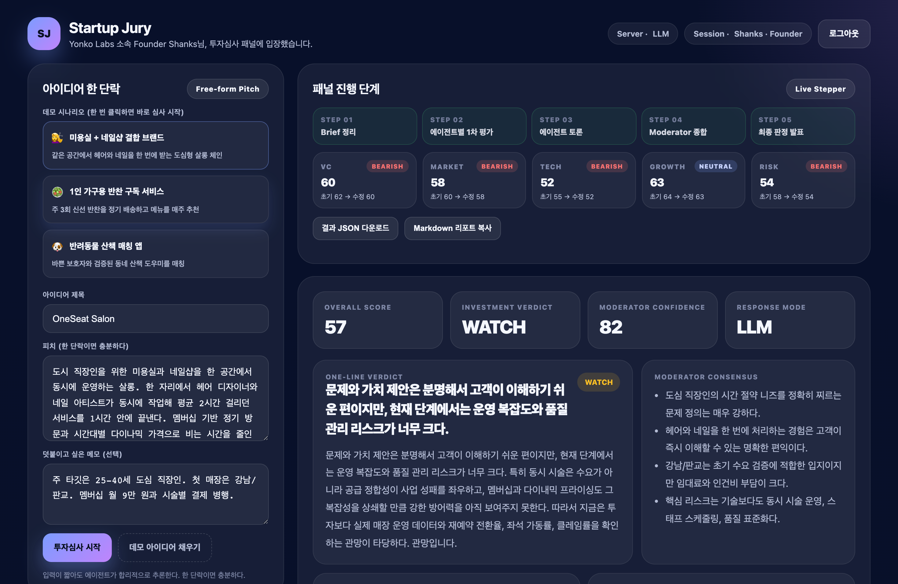
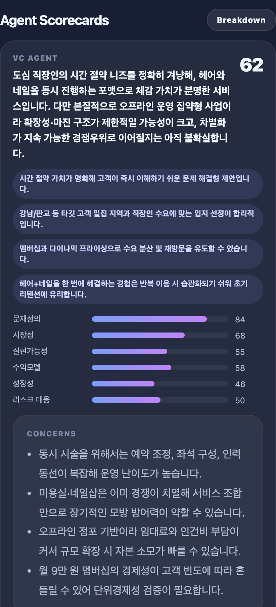
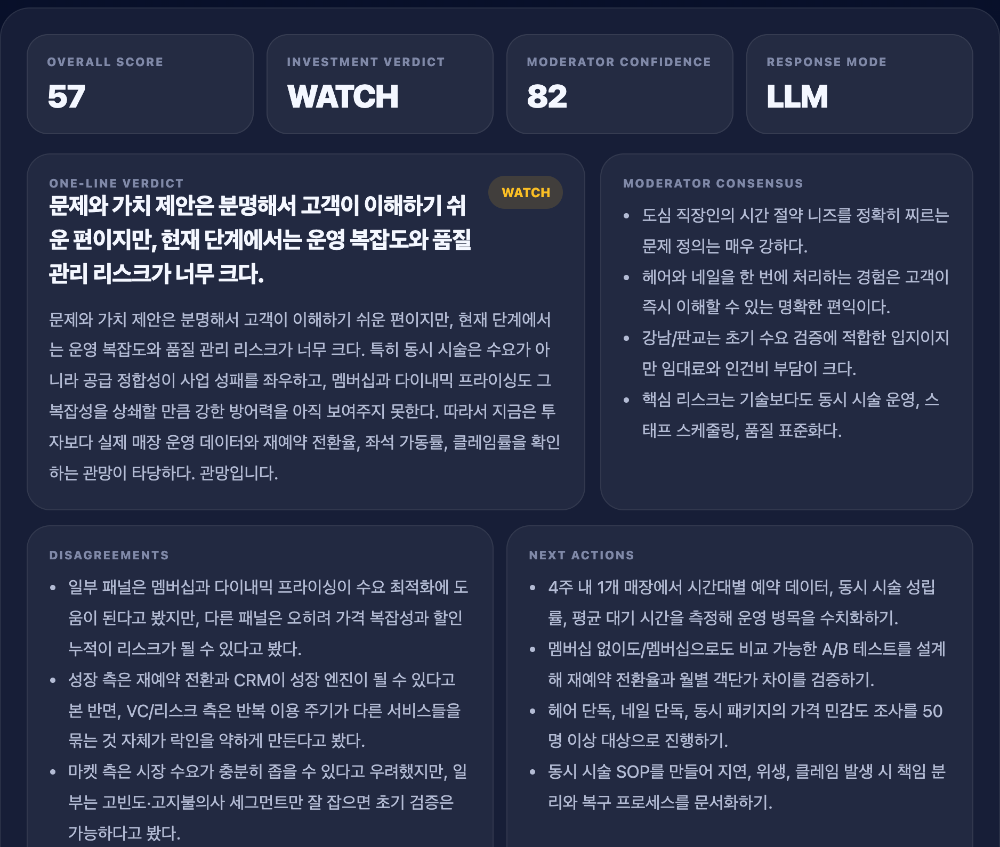

# Startup Jury

> 스타트업 피치를 심사하는 멀티 에이전트 "투자 심사위원회". AI 심사위원 다섯 명이 점수를 매기고 반박하면, Moderator가 최종 판정을 내립니다.

🇺🇸 [English README](README.md)



## 이 레포에 대해

2026년 5월 젠스파크(Genspark) 해커톤 제출작입니다. 제출 당시 버전은 git 태그 [`hackathon-submission`](../../tree/hackathon-submission)으로 남겨 두었습니다.
이후 커밋은 해커톤 뒤에 발견한 문서 오류와 버그를 고친 것입니다([해커톤 이후 변경 사항](#해커톤-이후-변경-사항) 참고).

투자 조언이 아니라 데모입니다. 자유롭게 쓰거나 포크하고, 문제가 있으면 이슈를 남겨 주세요.

## 빠른 시작

Node.js 20 이상이 필요합니다.

```bash
git clone https://github.com/cynkai/startup-jury.git
cd startup-jury
npm install
npm run dev
```

http://localhost:4000 을 엽니다. API 키가 없어도 됩니다. 키가 없으면 규칙 기반 평가기로 동작합니다(아래 참고).

LLM을 쓰려면 `.env.example`을 `.env`로 복사하고 `OPENAI_API_KEY`를 넣습니다. `OPENAI_BASE_URL`과 `OPENAI_MODEL`로 OpenAI 호환 엔드포인트를 쓸 수 있습니다.

| 변수 | 기본값 | 의미 |
|---|---|---|
| `PORT` | `4000` | HTTP 포트 |
| `OPENAI_API_KEY` | (비어 있음) | 비어 있으면 규칙 기반 모드 |
| `OPENAI_BASE_URL` | `https://api.openai.com/v1` | Chat Completions 엔드포인트 |
| `OPENAI_MODEL` | `gpt-4o-mini` | 모델 이름 |

## 동작 방식

심사위원은 VC, Market, Tech, Growth, Risk 에이전트이고, Moderator가 진행합니다.

**LLM 모드** (`OPENAI_API_KEY` 설정 시)
1. 심사위원마다 피치를 0~100점으로 평가하고 강점, 우려, 제안을 냅니다.
2. 심사위원마다 다른 심사위원의 평가를 한 번 읽고 반박과 수정 점수를 냅니다.
3. Moderator가 합의점, 이견, 신뢰도를 정리합니다.
4. 종합 점수는 수정 점수의 평균입니다. 78 이상 `invest`, 55 이상 `watch`, 그 아래는 `pass`입니다.

LLM 호출이 실패하면 규칙 기반 결과를 돌려주고 `meta.llmError`에 이유를 적습니다.

**규칙 기반 모드** (키 없음)는 피치에서 키워드(타깃 고객, 수익 모델, 가격, 유입 채널, 경쟁사, MVP 범위, 규제 도메인, 하드웨어 등)를 찾아
고정 가중치로 점수를 만듭니다. 결과가 항상 같아서 UI를 써 보기에는 좋지만, 아이디어를 이해하지는 못합니다.

**알려진 한계:** 화면의 대화형 토론 기록은 순서와 문장이 고정된 템플릿에 에이전트의 점수와 텍스트를 채운 것입니다.
실제로는 에이전트끼리 한 번만 의견을 주고받는데도 토론처럼 읽힙니다. 실제 발언으로 대화록을 만드는 방식으로 바꾸는 중입니다.

로그인 화면은 표시 이름을 브라우저 `localStorage`에 저장할 뿐이고, 인증은 없습니다.

## API

| 메서드 | 경로 | 설명 |
|---|---|---|
| `GET` | `/health` | 상태와 모드(`llm` 또는 `fallback`) |
| `GET` | `/agents` | 심사위원 목록 |
| `GET` | `/scenarios` | 내장 데모 피치 |
| `POST` | `/evaluate` | 피치 평가 |

`POST /evaluate` 요청 본문:

| 필드 | 타입 | 규칙 |
|---|---|---|
| `title` | 문자열 | 2~80자 |
| `pitch` | 문자열 | 10~1200자 |
| `notes` | 문자열, 선택 | 800자 이하 |

```bash
curl -s http://localhost:4000/evaluate \
  -H 'Content-Type: application/json' \
  -d '{
    "title": "PawWalk",
    "pitch": "바쁜 반려동물 보호자와 검증된 동네 산책 도우미를 연결하는 모바일 매칭 서비스. 산책 경로와 사진을 실시간으로 공유한다.",
    "notes": "도우미 수수료 20%. 첫 도시는 서울. 반려견 카페와 제휴해 도우미 풀 확보."
  }'
```

응답에는 `evaluations`(심사위원별), `debate`, `transcript`, `moderator`, `finalAssessment`, `meta`가 들어 있습니다.
본문이 규칙에 맞지 않으면 검증 상세와 함께 `400`을 돌려줍니다.

## 화면

데모 시나리오를 고르거나 피치를 직접 입력하고, 심사 과정을 본 뒤 결과를 JSON으로 내려받거나 Markdown 리포트로 복사할 수 있습니다.

| 토론 | 스코어카드 | 판정 |
|---|---|---|
|  |  |  |

[아키텍처 다이어그램](docs/images/architecture.png)은 해커톤 제출 당시 그대로입니다. "Storage (Optional)" 상자는 구현되지 않았습니다.

## 프로젝트 구조

```
src/
  server.ts             Express 앱과 라우트
  agents.ts             심사위원 정의
  llmEvaluator.ts       LLM 모드
  fallbackEvaluator.ts  규칙 기반 모드
  normalize.ts          두 모드가 쓰는 키워드 신호
  schema.ts             요청 검증(Zod)
  scenarios.ts          데모 피치
  utils.ts, types.ts, config.ts
public/
  index.html            단일 페이지 UI(빌드 단계 없음)
```

## 해커톤 이후 변경 사항

- README를 코드에 맞게 다시 썼습니다(예전 예시 요청에는 API가 받지 않는 필드가 들어 있었습니다).
- 예전 README가 언급하던 MIT `LICENSE` 파일을 추가했습니다.

## 라이선스

[MIT](LICENSE)
