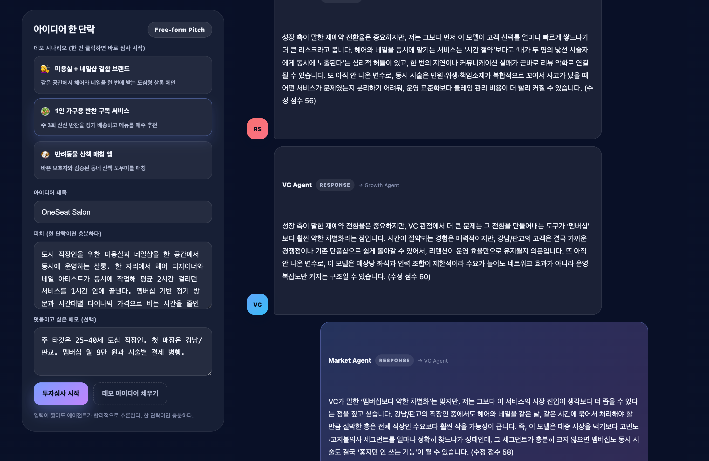

# Startup Jury

> 스타트업 피치를 심사하는 멀티 에이전트 "투자 심사위원회". AI 심사위원 다섯 명이 점수를 매기고 반박하면, Moderator가 최종 판정을 내립니다.

🇺🇸 [English README](README.md)


## 이 레포에 대해

2026년 5월 젠스파크(Genspark) 해커톤 제출작입니다. 제출 당시 버전은 git 태그 [`hackathon-submission`](../../tree/hackathon-submission)으로 남겨 두었습니다.
이후 커밋은 해커톤 뒤에 발견한 문서 오류와 버그를 고친 것입니다([해커톤 이후 변경 사항](#해커톤-이후-변경-사항) 참고).

투자 조언이 아니라 데모입니다. 자유롭게 쓰거나 포크하고, 문제가 있으면 이슈를 남겨 주세요.

## 빠른 시작

Node.js 20 이상이 필요합니다.

```bash
git clone https://github.com/cynkai/startup-jury.git
cd startup-jury
npm install
npm run dev
```

http://localhost:4000 을 엽니다. API 키가 없어도 됩니다. 키가 없으면 규칙 기반 평가기로 동작합니다(아래 참고).

LLM을 쓰려면 `.env.example`을 `.env`로 복사하고 `OPENAI_API_KEY`를 넣습니다. `OPENAI_BASE_URL`과 `OPENAI_MODEL`로 OpenAI 호환 엔드포인트를 쓸 수 있습니다.

| 변수 | 기본값 | 의미 |
|---|---|---|
| `PORT` | `4000` | HTTP 포트 |
| `OPENAI_API_KEY` | (비어 있음) | 비어 있으면 규칙 기반 모드 |
| `OPENAI_BASE_URL` | `https://api.openai.com/v1` | Chat Completions 엔드포인트 |
| `OPENAI_MODEL` | `gpt-5.4-mini` | 모델 이름 |
| `OPENAI_TEMPERATURE` | (모델 기본값) | 선택. 일부 모델(gpt-5.5 등)은 기본값 외에는 거부합니다 |
| `OPENAI_REASONING_EFFORT` | (모델 기본값) | 선택. 추론 모델용 |
| `DEBATE_ROUNDS` | `2` | LLM 모드의 토론 라운드 수(1~3) |

> **로컬에서 실행하세요.** 서버에는 인증도, 호출 제한도 없고 모든 출처(CORS)를 허용합니다.
> `OPENAI_API_KEY`를 넣은 채 공개된 곳에 배포하면, 주소를 아는 누구나 평가 한 번에 16번씩 여러분의 API 크레딧을 쓸 수 있습니다.

## 동작 방식

심사위원은 VC, Market, Tech, Growth, Risk 에이전트이고, Moderator가 진행합니다.

**LLM 모드** (`OPENAI_API_KEY` 설정 시)
1. **1차 평가:** 심사위원마다 피치를 0~100점으로 평가하고 강점, 우려, 제안을 냅니다. 서로 영향을 주지 않도록 동시에 실행합니다.
2. **토론:** `DEBATE_ROUNDS` 라운드(기본 2). 심사위원이 정해진 순서로 한 명씩 발언합니다. 발언자는 1차 평가 전부와 앞선 발언을 모두 보고,
   답할 패널 한 명을 지목하며, 점수를 바꿀 수 있습니다.
3. **Moderator:** 전체를 읽고 최종 판정(`invest`, `watch`, `pass`)을 내리며, 합의점, 이견, 신뢰도, 다음 액션을 정리합니다.
   종합 점수는 심사위원 최종 점수의 평균입니다. 점수만으로 정해지는 판정(78 이상 `invest`, 55 이상 `watch`, 그 아래 `pass`)은 `scoreVerdict`로 함께 남기고,
   Moderator가 다르게 판단하면 그 이유를 적습니다.

평가 한 번에 5 + 5 × 라운드 + 1번 호출합니다(기본 16번). 토론 호출은 순서대로 진행되므로 시간이 걸립니다.
화면의 대화록은 이 출력만으로 만들고, 고정 문구는 Moderator의 시작과 판정 문장뿐입니다.

피치는 신뢰할 수 없는 입력으로 취급합니다. 피치 스스로 닫을 수 없는 `<pitch>` 태그로 감싸고, 프롬프트에서 데이터로만 다루라고 지시합니다.
프롬프트 인젝션을 어렵게 할 뿐 완전히 막지는 못합니다. 화면은 모델 출력을 이스케이프해서 표시합니다.

OneSeat Salon 시나리오(2라운드)의 실제 결과를 모델별로 [docs/examples](docs/examples)에 남겨 두었습니다.

| 모델 | 시간 | 토큰 (입력 / 출력) | 1차 점수 | 판정 | 비고 |
|---|---|---|---|---|---|
| gpt-4o-mini | 약 36초 | — | 67~72 | 관망 (68) | 일반론 위주. 따로 지시하기 전에는 서로 동의하고 반복함 |
| **gpt-5.4-mini** (기본값) | 약 41초 | 약 37k / 6k | 44~67 | 투자 보류 (53) | 두 직군 동시 배정, 멤버십 이탈 등 구체적인 반론 |
| gpt-5.5 | 약 125초 | 약 39k / 11k | 52~58 | 투자 보류 (54) | 멤버십 마진, 동시 시술 가능한 메뉴 조합, CAC, 환불 분쟁, 고객 사진 정보까지 가장 구체적. 약 3배 느림 |

응답의 `meta.usage`에 호출 수와 토큰 사용량이 들어 있습니다. 실행마다 결과가 달라서, 같은 모델과 같은 피치라도 판정이 바뀔 수 있습니다.

LLM 호출이 실패하면 규칙 기반 결과를 돌려주고 `meta.llmError`에 이유를 적습니다.

**규칙 기반 모드** (키 없음)는 피치에서 키워드(타깃 고객, 수익 모델, 가격, 유입 채널, 경쟁사, MVP 범위, 규제 도메인, 하드웨어 등)를 찾아
고정 가중치로 점수를 만듭니다. "토론"은 규칙으로 만든 발언 한 라운드이고, 판정은 점수를 따릅니다.
결과가 항상 같아서 UI를 써 보기에는 좋지만, 아이디어를 이해하지는 못합니다.

로그인 화면은 표시 이름을 브라우저 `localStorage`에 저장할 뿐이고, 인증은 없습니다.

## API

| 메서드 | 경로 | 설명 |
|---|---|---|
| `GET` | `/health` | 상태와 모드(`llm` 또는 `fallback`) |
| `GET` | `/agents` | 심사위원 목록 |
| `GET` | `/scenarios` | 내장 데모 피치 |
| `POST` | `/evaluate` | 피치 평가 |

`POST /evaluate` 요청 본문:

| 필드 | 타입 | 규칙 |
|---|---|---|
| `title` | 문자열 | 2~80자 |
| `pitch` | 문자열 | 10~1200자 |
| `notes` | 문자열, 선택 | 800자 이하 |

```bash
curl -s http://localhost:4000/evaluate \
  -H 'Content-Type: application/json' \
  -d '{
    "title": "PawWalk",
    "pitch": "바쁜 반려동물 보호자와 검증된 동네 산책 도우미를 연결하는 모바일 매칭 서비스. 산책 경로와 사진을 실시간으로 공유한다.",
    "notes": "도우미 수수료 20%. 첫 도시는 서울. 반려견 카페와 제휴해 도우미 풀 확보."
  }'
```

응답에는 `evaluations`(심사위원별), `debate`, `transcript`, `moderator`, `finalAssessment`, `meta`가 들어 있습니다.
본문이 규칙에 맞지 않으면 검증 상세와 함께 `400`을 돌려줍니다.

## 화면

데모 시나리오를 고르거나 피치를 직접 입력하고, 심사 과정을 본 뒤 결과를 JSON으로 내려받거나 Markdown 리포트로 복사할 수 있습니다.
스크린샷은 OneSeat Salon 시나리오를 gpt-5.4-mini로 실제 실행한 화면입니다.

| 토론 | 스코어카드 | 판정 |
|---|---|---|
|  |  |  |

[아키텍처 다이어그램](docs/images/architecture.png)은 해커톤 제출 당시 그대로입니다. "Storage (Optional)" 상자는 구현되지 않았습니다.

## 프로젝트 구조

```
src/
  index.ts              진입점(서버 시작)
  server.ts             Express 앱과 라우트
  agents.ts             심사위원 정의
  llmEvaluator.ts       LLM 모드
  fallbackEvaluator.ts  규칙 기반 모드
  transcript.ts         에이전트 출력으로 대화록 생성
  normalize.ts          두 모드가 쓰는 키워드 신호
  schema.ts             요청 검증(Zod)
  scenarios.ts          데모 피치
  utils.ts, types.ts, config.ts
public/
  index.html            단일 페이지 UI(빌드 단계 없음)
```

## 개발

```bash
npm test           # 단위·API 테스트 (API 키나 네트워크 필요 없음)
npm run typecheck
npm run build && npm start   # dist/에 프로덕션 빌드
```

## 해커톤 이후 변경 사항

- README를 코드에 맞게 다시 썼습니다(예전 예시 요청에는 API가 받지 않는 필드가 들어 있었습니다).
- 예전 README가 언급하던 MIT `LICENSE` 파일을 추가했습니다.
- 규칙 기반 모드의 키워드 매칭이 영어 단어를 단어 단위로 찾습니다("email"을 "AI"로, "Seoul"을 "SEO"로 세지 않음).
  "3월" 같은 날짜나 "예약", "요약"을 수익·규제 신호로 보지 않습니다.
- 테스트와 GitHub Actions CI를 추가했습니다.
- LLM 모드가 실제로 토론합니다. 라운드를 순서대로 진행하며 심사위원이 앞선 발언에 답하고, 대화록은 템플릿이 아니라 그 발언으로 만들며,
  Moderator가 최종 판정을 내립니다. 피치를 프롬프트 인젝션에 대비해 펜싱하고, 화면은 모델 출력을 이스케이프합니다.
- 기본 모델을 gpt-5.4-mini로 바꿨습니다(temperature를 강제하지 않아 GPT-5 계열도 동작합니다). Moderator 판정 용어를 정의했고,
  응답에 토큰 사용량을 넣었으며, `/agents`가 공용 에이전트 정의를 읽습니다.
- LLM 호출이 실패하면 조용히 대체하지 않고 화면에 원인을 표시합니다. 노트북과 휴대폰 너비에서 레이아웃이 넘치지 않게 고쳤고,
  스크린샷을 실제 LLM 실행 화면으로 다시 찍었습니다(예전 스크린샷은 없앤 템플릿 대화록을 보여줬습니다).

## 라이선스

[MIT](LICENSE)
