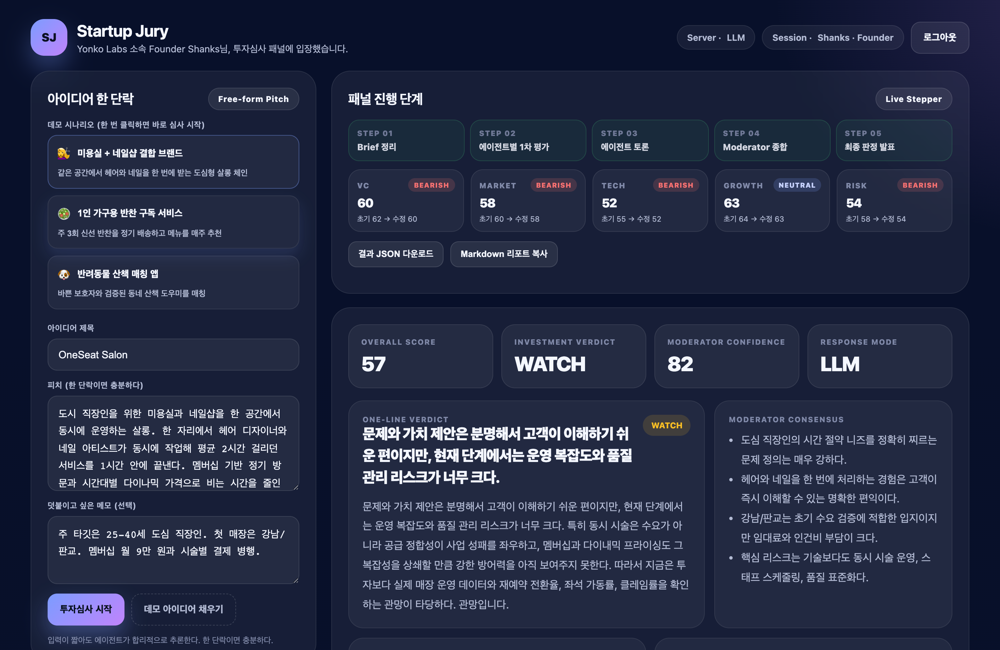
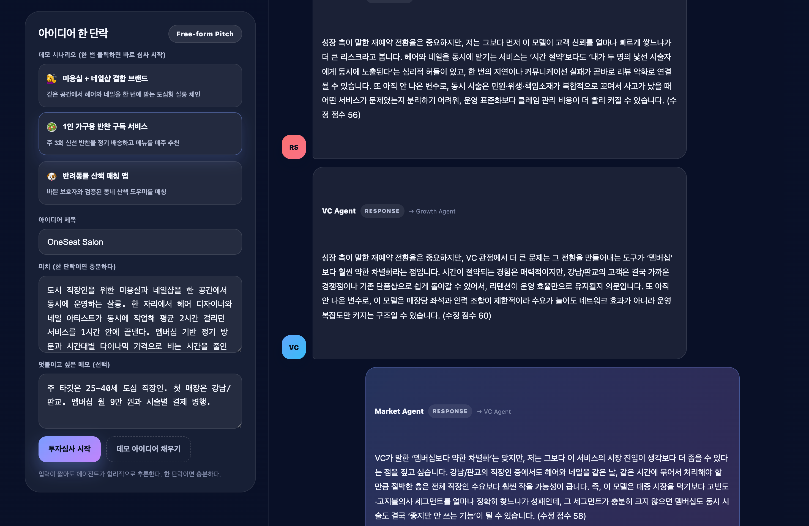
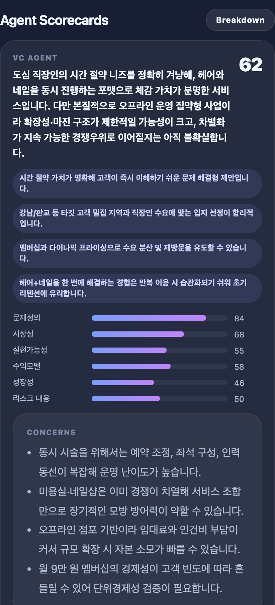
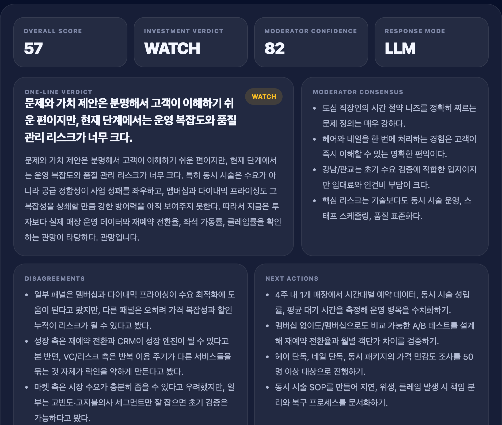

# Startup Jury

> A multi-agent "investment committee" that reviews a startup pitch: five AI reviewers score it, argue, and a moderator gives the verdict.

🇰🇷 [한국어 README](README.ko.md)



## About this repository

Startup Jury was built for the Genspark Hackathon in May 2026. The version submitted there is kept as the git tag
[`hackathon-submission`](../../tree/hackathon-submission). Later commits fix the documentation and bugs found after the event;
see [Changes since the hackathon](#changes-since-the-hackathon).

It is a demo, not investment advice. Feel free to use it, fork it, or open an issue.

## Quick start

Requires Node.js 20 or later.

```bash
git clone https://github.com/cynkai/startup-jury.git
cd startup-jury
npm install
npm run dev
```

Open http://localhost:4000. No API key is needed: without one, the server uses a rule-based evaluator (see below).

To use an LLM, copy `.env.example` to `.env` and set `OPENAI_API_KEY`. Any OpenAI-compatible endpoint works via `OPENAI_BASE_URL` and `OPENAI_MODEL`.

| Variable | Default | Meaning |
|---|---|---|
| `PORT` | `4000` | HTTP port |
| `OPENAI_API_KEY` | (empty) | Empty → rule-based mode |
| `OPENAI_BASE_URL` | `https://api.openai.com/v1` | Chat Completions endpoint |
| `OPENAI_MODEL` | `gpt-4o-mini` | Model name |

## How it works

The reviewers are VC, Market, Tech, Growth and Risk agents, plus a Moderator.

**LLM mode** (`OPENAI_API_KEY` set)
1. Each reviewer scores the pitch (0–100) with strengths, concerns and recommendations.
2. Each reviewer reads the others' evaluations once and returns rebuttals and a revised score.
3. The Moderator summarises consensus, disagreements and a confidence value.
4. The overall score is the mean of the revised scores: `invest` ≥ 78, `watch` ≥ 55, otherwise `pass`.

If an LLM call fails, the server answers with the rule-based result and adds `meta.llmError`.

**Rule-based mode** (no key) looks for keywords in the pitch (target customer, revenue model, pricing, channels, competitors, MVP scope, regulated domain, hardware, …)
and turns them into scores with fixed weights. It is deterministic and useful for trying the UI, but it does not understand the idea.

**Known limitation:** the chat-style transcript shown in the UI is a fixed sequence of lines filled in with the agents' scores and texts, so it reads like a debate
even though the agents only exchange one round. This is being replaced with a transcript built from the actual turns.

The login screen only stores a display name in the browser's `localStorage`; there is no authentication.

## API

| Method | Path | Description |
|---|---|---|
| `GET` | `/health` | Status and mode (`llm` or `fallback`) |
| `GET` | `/agents` | Reviewer list |
| `GET` | `/scenarios` | Built-in demo pitches |
| `POST` | `/evaluate` | Evaluate a pitch |

`POST /evaluate` body:

| Field | Type | Rule |
|---|---|---|
| `title` | string | 2–80 characters |
| `pitch` | string | 10–1200 characters |
| `notes` | string, optional | up to 800 characters |

```bash
curl -s http://localhost:4000/evaluate \
  -H 'Content-Type: application/json' \
  -d '{
    "title": "PawWalk",
    "pitch": "A mobile service that matches busy pet owners with verified neighbourhood dog walkers, with live route and photo sharing.",
    "notes": "20% commission. First city: Seoul. Partner with pet cafes to recruit walkers."
  }'
```

The response contains `evaluations` (per reviewer), `debate`, `transcript`, `moderator`, `finalAssessment` and `meta`.
An invalid body returns `400` with the validation details.

## UI

Pick a demo scenario or type a pitch, watch the panel, then export the result as JSON or copy a Markdown report.
The UI text is Korean.

| Debate | Scorecards | Verdict |
|---|---|---|
|  |  |  |

The [architecture diagram](docs/images/architecture.png) is the one submitted to the hackathon; its "Storage (optional)" box was never implemented.

## Project structure

```
src/
  index.ts              Entry point (starts the server)
  server.ts             Express app and routes
  agents.ts             Reviewer definitions
  llmEvaluator.ts       LLM mode
  fallbackEvaluator.ts  Rule-based mode
  normalize.ts          Keyword signals used by both modes
  schema.ts             Request validation (Zod)
  scenarios.ts          Demo pitches
  utils.ts, types.ts, config.ts
public/
  index.html            Single-page UI (no build step)
```

## Development

```bash
npm test           # unit and API tests (no API key or network needed)
npm run typecheck
npm run build && npm start   # production build in dist/
```

## Changes since the hackathon

- README rewritten to match the code (the old example request used fields the API does not accept).
- Added the MIT `LICENSE` file the old README referred to.
- Keyword matching in rule-based mode now matches whole English words ("email" no longer counts as "AI", "Seoul" as "SEO")
  and no longer treats month names, "예약" or "요약" as revenue or regulation signals.
- Added tests and GitHub Actions CI.

## License

[MIT](LICENSE)
